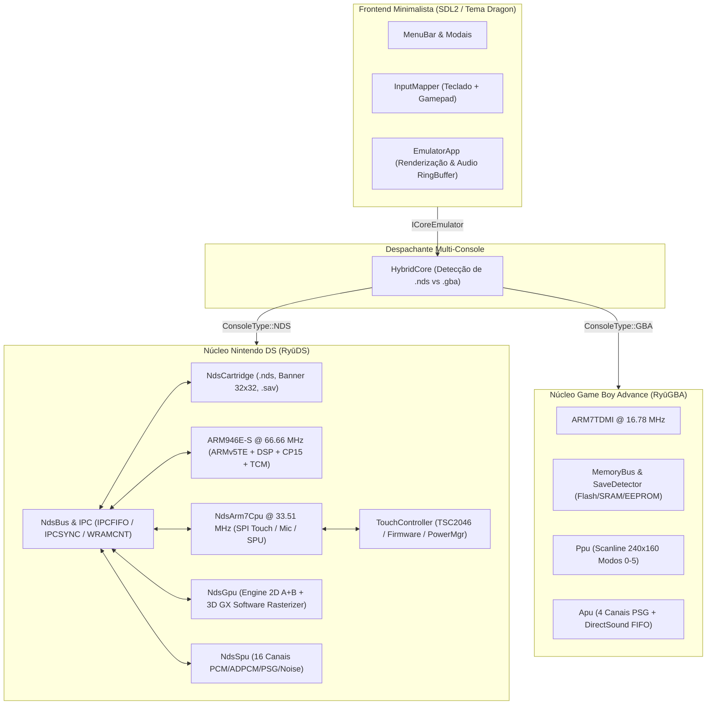

# 🐉 RyūDS / RyūGBA — Emulador Híbrido de Nintendo DS e Game Boy Advance

> **Edição Dragon (Ryū) | Filosofia e UX estilo melonDS | Arquitetura C++20 & SDL2**

**RyūDS / RyūGBA** é um emulador multi-console de alto desempenho e precisão para **Nintendo DS (`.nds`, `.dsi`, `.srl`)** e **Game Boy Advance (`.gba`, `.agb`)**, projetado sob a filosofia de **minimalismo funcional, latência mínima e desacoplamento rigoroso entre Core e Frontend** inspirada no **melonDS**, combinada a uma identidade visual autoral estilizada baseada em dragões (**Dragon / Ryū**).

---

## 📑 Sumário
1. [Identidade Visual e Filosofia de Design](#-identidade-visual-e-filosofia-de-design)
2. [Arquitetura Geral do Sistema](#-arquitetura-geral-do-sistema)
3. [Sub-Sistemas do Nintendo DS (RyūDS)](#-sub-sistemas-do-nintendo-ds-ryūds)
4. [Sub-Sistemas do Game Boy Advance (RyūGBA)](#-sub-sistemas-do-game-boy-advance-ryūgba)
5. [Controles, Stylus Touchscreen, Microfone e Tampa](#-controles-stylus-touchscreen-microfone-e-tampa)
6. [Estrutura da Barra de Menus (Layout melonDS)](#-estrutura-da-barra-de-menus-layout-melonds)
7. [Árvore Completa do Código-Fonte](#-árvore-completa-do-código-fonte)
8. [Pré-Requisitos e Compilação](#-pré-requisitos-e-compilação)
9. [Execução e Modos de Operação](#-execução-e-modos-de-operação)
10. [Suíte de Testes Automatizados (11 Módulos)](#-suíte-de-testes-automatizados-11-módulos)
11. [Atalho na Área de Trabalho (Desktop Launcher)](#-atalho-na-área-de-trabalho-desktop-launcher)

---

## 🎨 Identidade Visual e Filosofia de Design

O projeto rejeita interfaces pesadas, dependências complexas de webview ou telas de carregamento desnecessárias, priorizando **abertura instantânea de ROMs**, **máxima taxa de quadros** e **clareza visual**.

- **Paleta de Cores Dragon:**
  - *Fundo principal (Ardósia profunda / Grafite obsidiana):* `#121316` / `#1a1c23`
  - *Superfícies de modais, diálogos e menus (Escamas polidas / Metal escuro):* `#22252e`
  - *Bordas sutis e divisórias:* `#353a48`
  - *Acentos dracônicos primários (Vermelho Fogo):* `#e63946`
  - *Acentos dracônicos secundários (Escamas Esmeralda):* `#10b981`
  - *Texto principal e secundário:* `#f1f3f7` / `#a0a8ba`
- **Logotipo Vetorial SVG (`assets/ryu_logo.svg` & `assets/ryu_icon.svg`):**
  - Desenho vetorial estilizado combinando a cabeça e olho de um dragão a um D-Pad e cartucho clássico.
  - Rasterização vetorial com *Supersampling 4x4 MSAA* nativa em C++ ([`SvgLogoRenderer`](file:///home/kaue/Downloads/projetos/gba-emulator/src/ui/SvgLogoRenderer.cpp)), aplicada no ícone da janela, na tela inicial (*Idle Screen*) e no diálogo *About*.
- **Notificações OSD Minimalistas:**
  - Pílula translúcida no canto inferior esquerdo exibindo mensagens de estado (volume, slots de save, hotkeys, status de microfone/tampa) e o **ícone 32x32 do cartucho DS** recém-carregado.

---

## 🏛 Arquitetura Geral do Sistema

O emulador adota uma separação total entre o motor de emulação de baixo nível e a interface com o usuário por meio da interface pura [`ICoreEmulator`](file:///home/kaue/Downloads/projetos/gba-emulator/include/core/ICoreEmulator.hpp).



---

## ⚡ Sub-Sistemas do Nintendo DS (RyūDS)

### 1. Leitor de Cartuchos e Saves (`NdsCartridge`)
- **Parser de Cabeçalho `.nds`:** Extrai metadados completos (`Game Title`, `Game Code`, `Maker Code`, `Unit Code` NDS/DSi, capacidade, offsets e endereços de carga em RAM do ARM9/ARM7 e CRC16).
- **Banner e Ícone 32x32:** Extrai o banner gráfico animável/estático de 32x32 pixels em 16 cores (4bpp tiled BGR555) e o título UTF-16LE, convertendo-os para ARGB8888 e UTF-8 para exibição no OSD e diálogos.
- **Protocolo de Barramento de Cartucho (ROM Card Bus):**
  - Streaming linear contínuo e sequencial para comandos `0xB7` (Read Data) e `0xBA` (Read Secure Area), sem corromper estruturas do sistema de arquivos NitroSDK (FAT/FNT, overlays) e sem wrap incorreto de páginas de 4KB.
  - Respostas completas para comandos `0x00` (Header), `0x90`/`0x9F`/`0xB8` (Chip ID `0x00001FC2`), `0x3C` (KEY1 mode switch) e `0x40..0x4F` (KEY2) sem retenção indevida do bit Busy de `ROMCTRL`.
- **Direct Boot / HLE pós-firmware (Padrão):** Inicializa o sistema no estado pós-firmware padrão da Nintendo sem depender de BIOS externa, configurando a área `0x027FF800..0x027FFFFF`, cabeçalho em `0x027FFE00`, User Settings com calibração 1:1 em `0x027FFC80` e registradores de CPU.
- **Suporte a BIOS Real (Opcional):** Suporta `bios9.bin` (4 KB), `bios7.bin` (16 KB) e `firmware.bin` (256/512 KB) se configurados pelo usuário.
- **Gerenciador Universal de Saves (.sav com Auto-Detection & Dynamic Resize):**
  - Suporte completo a **EEPROM 4Kb (512B)**, **EEPROM 64Kb (8KB)**, **EEPROM 512Kb (64KB)**, **Flash 256KB/512KB/1MB/8MB** e **FRAM 32KB**.
  - Detecção dinâmica baseada em Game Code, varredura de assinaturas do NitroSDK e promoção em tempo de execução: comandos como `0x9F` (JEDEC RDID), `0xAB` (Read Signature) ou `0xD8`/`0xDB` (Sector/Page Erase) expandem dinamicamente a memória de save preservando dados existentes.
  - O registrador de status (RDSR `0x05`) retorna `WIP = 0` imediato, prevenindo congelamentos em telas de "Now Saving..." ou "Checking save data".

### 2. Dual-Core Lockstep (ARM946E-S + ARM7TDMI)
- **ARM946E-S (Main CPU @ 66.66 MHz):**
  - Instruções ARMv5TE: `BLX`, `CLZ`, `LDRD`/`STRD`, `PLD`, interworking com desvio para Thumb em `LDR PC`, `LDM {..PC}` e `POP {..PC}`.
  - Instruções de processamento de sinal DSP: `QADD`, `QSUB`, `QDADD`, `QDSUB`, `SMLAxy`, `SMLAWy`, `SMULWy`, `SMLALxy`, `SMULxy` e flag sticky `Q`.
  - Coprocessador **CP15**: identificador de arquitetura ARM946E-S (`0x41059461`), controle de proteção, e mapeamento das memórias acopladas:
    - **ITCM (Instruction TCM - 32 KB)**
    - **DTCM (Data TCM - 16 KB)** com resolução de prioridade antes do barramento principal.
- **ARM7TDMI (Sub CPU @ 33.51 MHz):**
  - Relação de clock 1:2 com o ARM9 (lockstep com quantuns de 32 ciclos ARM7 / 64 ciclos ARM9 ao longo de 560.190 ciclos por frame).
  - Controle de barramento SPI (Touchscreen TSC2046, Firmware, Power Management), `EXTKEYIN` e os 16 canais da SPU.
- **Barramento Compartilhado e IPC (`NdsBus`):**
  - FIFOs bidirecionais de 16 palavras (`IPCFIFO`) com interrupções `IpcSendEmpty` e `IpcRecvNotEmpty` precisas de ciclo acordando processadores do estado `HALT` e chamadas de `IntrWait`.
  - Registradores de sincronismo `IPCSYNC` de 4 bits bidirecionais.
  - Resolução direta de registradores MMIO com eliminação de recursão mútua e desacoplamento seguro de portas de 16 e 32 bits.
  - **Shared WRAM (32 KB):** chaveamento dinâmico via registrador `WRAMCNT` (ambos os blocos no ARM9, ambos no ARM7 ou divididos 16KB/16KB).
  - 4 MB de Main RAM, 64 KB de ARM7 WRAM e 9 bancos físicos de VRAM (A–I, 656 KB total).
  - Coprocessadores matemáticos em hardware do ARM9: **DIV** (64/32 e 32/32 bits) e **SQRT** (raiz quadrada de 64 e 32 bits).

### 3. Pipeline Gráfico Dual-Screen 2D + 3D (`NdsGpu`)
- **Duas Engines 2D (Engine A + Engine B, 256x192 cada):**
  - Modos de vídeo 0 a 5 com suporte a camadas Text, Affine e Extended Affine (mapas de 16 bits, bitmaps de 8 bits e bitmaps Direct Color de 15 bits em 0x06200000).
  - Modo direto de display de VRAM LCDC (Bancos A–D).
  - Sprites OAM (128 por engine) com suporte a rotação/escala e prioridades.
  - Master Brightness e display swap via `POWCNT1` (inversão da engine A e B entre telas física superior e inferior).
- **Engine 3D (Geometry Engine GXFIFO + Rasterizador de Software Z-Buffered):**
  - Pilhas de matrizes (Projection, Position/Vector e Texture).
  - Transformações de vértices (comandos `VTX_16`, `VTX_10`, `VTX_XY`, `VTX_XZ`, `VTX_YZ`, `VTX_DIFF`).
  - Iluminação direcional (4 fontes de luz com cálculo vetorial, diffuse, ambient e specular).
  - Rasterizador com interpolação de profundidade Z perspectiva-correta, amostragem de texturas VRAM (A3I5, 4 cores, 16 cores, 256 cores, A5I3) e composição direta sobre a camada BG0 da Engine A.

### 4. Áudio NDS de 16 Canais (`NdsSpu`)
- 16 canais de som independentes com controle de volume, panning estéreo e frequência:
  - Canais 0 a 15: PCM8, PCM16, IMA-ADPCM.
  - Canais 8 a 13: PSG Square waves com duty cycle configurável (12.5%, 25%, 50%, 75%, etc.).
  - Canais 14 e 15: Gerador de Ruído Branco (White Noise).

---

## 🎮 Sub-Sistemas do Game Boy Advance (RyūGBA)

- **CPU ARM7TDMI:** Decodificador de instruções duplas (ARM 32 bits e THUMB 16 bits) com pipeline e execução de vetores SWI de BIOS HLE (`0x01 RegisterRamReset`, `0x02 Halt`, `0x04 IntrWait`, `0x05 VBlankIntrWait`, `0x0B CpuSet`, `0x11/0x12 LZ77UnComp`).
- **Memory Bus e Save RAM:**
  - Barramento plano mapeando BIOS, EWRAM (256 KB), IWRAM (32 KB), I/O, Paleta (1 KB), VRAM (96 KB), OAM (1 KB) e ROMs até 32 MB.
  - Auto-detecção de backup e suporte completo a SRAM (32 KB), Flash 64 KB, Flash 128 KB (com troca de banco `0x5555/0x2AAA/0xB0`) e EEPROM (4k/64k).
- **PPU (Vídeo Scanline 240x160):**
  - Suporte aos Modos de 0 a 5, camadas de Background (BG0–BG3) e renderizador de Sprites OAM com Alpha Blending e Brightness.
- **APU (Áudio):**
  - 4 canais clássicos PSG (Square 1 com Sweep, Square 2, Wave customizada, Noise) e 2 canais DirectSound (A e B) alimentados por DMA e FIFOs sincronizados com buffer circular lock-free.

---

## 🕹 Controles, Stylus Touchscreen, Microfone e Tampa

### 1. Mapeamento de Controles (12 Botões)
Acessível em `Config -> Input and Hotkeys...`:
- Colunas independentes para **Teclado** e **Gamepad / Joystick** com clique para captura (`"Listening..."`).
- **10 Botões GBA/DS:** `A`, `B`, `L`, `R`, `Start`, `Select`, `Cima`, `Baixo`, `Esquerda`, `Direita`.
- **2 Botões Exclusivos DS:** `X` e `Y` (mapeados no registrador `EXTKEYIN`).

### 2. Touchscreen (Stylus)
- Clique e arraste com o botão esquerdo do mouse sobre a tela inferior.
- Mapeamento analógico exato para as coordenadas `0..255` x `0..191` do controlador SPI `TSC2046` e bit `PenDown` do `EXTKEYIN`.
- Funciona uniformemente em qualquer resolução, proporção de aspecto ou layout de tela (inclusive com telas invertidas ou no modo miniatura PiP).
- **Cursor Temático Dragon Stylus:** retículo geométrico suave que indica o ponto de contato da caneta (verde esmeralda ao pairar, vermelho carmesim ao pressionar).

### 3. Microfone e Tampa (Sensores NDS)
- **Sopro no Microfone (Mic Blow):** Tecla `M` por padrão (ou botão de controle). Gera ruído branco de alta fidelidade via LFSR de 32 bits no canal ADC 6 do `TSC2046`, satisfazendo jogos que exigem sopro (como *Zelda: Phantom Hourglass*).
- **Tampa / Sleep Mode (Lid Sleep):** Tecla `F7` por padrão. Dispara a interrupção de hardware `LidHinge` no ARM7, silenciando o áudio e acionando o modo de suspensão de bateria dos jogos.

### 4. Sistema de Fast Forward (Aceleração até 8x Real & Uncapped)
- **Modos de Acionamento:**
  - **Hold (Segurar):** Acelera a emulação apenas enquanto a tecla de atalho (`Tab` ou botão configurado) permanecer pressionada, retornando instantaneamente para 100% ao soltar.
  - **Toggle (Alternar):** Um toque liga a aceleração contínua e outro toque desliga.
- **Multiplicadores de Velocidade:**
  - `2x` (120 FPS), `4x` (240 FPS), `8x` (480 FPS) e `Uncapped` (velocidade máxima permitida pela CPU).
- **Intelligent Frame Skipping:**
  - Nos multiplicadores elevados (até 8x), o pipeline executa a emulação completa de CPU, barramento, DMA e timers em todos os quadros, mas pula a rasterização pesada de scanlines e geometria 3D nos quadros intermediários (`skipRendering = true`).
  - A renderização final e apresentação SDL ocorrem a 60 Hz no último quadro de cada lote, eliminando gargalos de GPU e alcançando 8.0x reais sem engasgos.
- **Dreno Não-Bloqueante de Áudio:**
  - Durante o avanço rápido, o buffer circular de áudio descarta amostras excedentes de forma atômica e não-bloqueante, evitando *backpressure* de áudio que travaria o loop principal.
- **Dragon HUD Badge:**
  - Pílula visual no canto superior direito da tela indicando a ativação e a taxa atual (`FF 2x`, `FF 4x`, `FF 8x` ou `FF MAX`), desenhada com o tema Dragon (fundo grafite e borda vermelha fogo).

---

## 🖥 Estrutura da Barra de Menus (Layout melonDS)

```text
├── File
│   ├── Open ROM... (Ctrl+O)
│   ├── Open Recent > (Lista de ROMs recentes com tags [NDS] / [GBA])
│   │   └── Clear Recent List
│   ├── Launch Built-in RyūDS Demo
│   ├── ------------------------------------
│   ├── Pause / Resume (P)
│   ├── Reset System (Ctrl+R)
│   └── Exit (Ctrl+Q)
├── Emulation
│   ├── Speed >
│   │   ├── 100% (Normal)
│   │   ├── 150%
│   │   ├── 200%
│   │   ├── 300%
│   │   └── Uncapped (Max FPS)
│   ├── Fast Forward >
│   │   ├── Mode: Hold (Segurar) / Toggle (Alternar)
│   │   ├── Multiplier: 2x (120 FPS)
│   │   ├── Multiplier: 4x (240 FPS)
│   │   ├── Multiplier: 8x (480 FPS)
│   │   └── Multiplier: Uncapped (Máximo)
│   ├── Fast Forward On/Off (Tab)
│   ├── DS Screen Layout >
│   │   ├── Vertical (Padrão DS)
│   │   ├── Horizontal (Lado a Lado)
│   │   ├── Foco Único (Single Focus + PiP)
│   │   └── Inverter Telas Top/Bottom (F6)
│   ├── Swap Top/Bottom Screens (F6)
│   ├── Close DS Lid / Sleep Mode (F7)
│   ├── Direct Boot / HLE (Ativado por padrão)
│   ├── ------------------------------------
│   ├── Save State > (Slots 1 a 9)
│   └── Load State > (Slots 1 a 9)
├── Config
│   ├── Input and Hotkeys... (12 botões + 7 hotkeys, Teclado + Gamepad)
│   ├── Video Settings... (Escalas 1x-4x, Proporção, Layouts NDS, Filtro Bilinear)
│   └── Audio Settings... (Volume Mestre 0-100%, Mute, Buffer, Sample Rate)
└── Help
    ├── About RyūDS / RyūGBA... (Logo vetorial, ícone de banner NDS, metadados)
    └── GitHub / Licença...
```

---

## 📁 Árvore Completa do Código-Fonte

```text
gba-emulator/
├── assets/
│   ├── ryu_logo.svg               # Logotipo vetorial oficial Dragon (Dragão + D-Pad + Cartucho)
│   ├── ryu_icon.svg               # Ícone vetorial 64x64 para janela e atalho Desktop
│   ├── ryugba.desktop             # Arquivo de entrada Desktop (MIMEs .nds e .gba)
│   └── dragon_theme.css           # Tokens de estilo e paleta oficial Dragon
├── include/
│   └── core/
│       ├── ICoreEmulator.hpp      # Interface abstrata pura de desacoplamento Core <-> Frontend
│       ├── HybridCore.hpp         # Despachante unificado multi-console NDS + GBA
│       ├── GbaCore.hpp            # Núcleo de emulação de GBA
│       ├── SaveStateStream.hpp    # Serializador/desserializador binário de Save States
│       ├── cpu/
│       │   └── Arm7Tdmi.hpp       # CPU ARM7TDMI (GBA)
│       ├── ppu/
│       │   └── Ppu.hpp            # PPU Scanline 240x160 (GBA)
│       ├── apu/
│       │   └── Apu.hpp            # APU PSG + DirectSound (GBA)
│       ├── memory/
│       │   ├── MemoryBus.hpp      # Barramento plano de memória (GBA)
│       │   └── save/              # Mídias de backup GBA (SRAM, Flash, EEPROM)
│       ├── input/
│       │   └── InputManager.hpp   # Mapeamento do registrador KEYINPUT (GBA)
│       └── nds/
│           ├── NdsCore.hpp        # Coordenador Dual-Core Nintendo DS (ARM9 + ARM7)
│           ├── NdsCartridge.hpp   # Parser .nds, decodificador de Banner 32x32 e AUXSPI .sav
│           ├── Arm9Cpu.hpp        # ARM946E-S @ 66.66 MHz (ARMv5TE + DSP + CP15 + ITCM/DTCM)
│           ├── NdsArm7Cpu.hpp     # ARM7TDMI @ 33.51 MHz para Nintendo DS
│           ├── NdsBus.hpp         # Barramento NDS, IPC (FIFO/SYNC), Shared WRAM, DIV/SQRT
│           ├── NdsGpu.hpp         # Engine 2D A+B (256x192) + Engine 3D GX Software Rasterizer
│           ├── NdsSpu.hpp         # SPU 16 canais (PCM8/PCM16/ADPCM/PSG/Noise)
│           ├── TouchController.hpp# Barramento SPI (TSC2046, Firmware, Power Management, Mic)
│           └── BuiltInNdsDemoRom.hpp # Gerador da ROM embutida de demonstração 3D + Stylus
├── src/
│   ├── core/                      # Implementação dos núcleos GBA, NDS e HybridCore
│   │   ├── HybridCore.cpp
│   │   ├── GbaCore.cpp
│   │   └── nds/
│   │       ├── NdsCartridge.cpp
│   │       ├── Arm9Cpu.cpp
│   │       ├── NdsArm7Cpu.cpp
│   │       ├── NdsBus.cpp
│   │       ├── NdsGpu.cpp
│   │       ├── NdsSpu.cpp
│   │       ├── TouchController.cpp
│   │       └── BuiltInNdsDemoRom.cpp
│   ├── config/
│   │   ├── ConfigManager.hpp      # Gerenciador de configuração JSON (~/.config/ryugba/config.json)
│   │   └── ConfigManager.cpp
│   ├── input/
│   │   ├── InputMapper.hpp        # Captura interativa de eventos Teclado + SDL GameController
│   │   └── InputMapper.cpp
│   ├── ui/
│   │   ├── DragonTheme.hpp        # Cores, fontes e primitivas gráficas
│   │   ├── SvgLogoRenderer.hpp    # Rasterizador vetorial SVG 4x4 MSAA nativo
│   │   ├── SvgLogoRenderer.cpp
│   │   ├── MenuBar.hpp            # Barra de menus estilo melonDS
│   │   ├── MenuBar.cpp
│   │   ├── Modals.hpp             # Modais (Input, Video, Audio, Open ROM, About, License)
│   │   └── Modals.cpp
│   ├── frontend/
│   │   ├── EmulatorApp.hpp        # Aplicação gráfica SDL2, áudio, layouts e loop de frames
│   │   ├── EmulatorApp.cpp
│   │   └── main.cpp               # Ponto de entrada CLI e diagnóstico headless
│   └── tests/
│       └── CoreSelfTest.cpp       # Suíte com 11 testes automatizados (GBA + NDS + UI)
└── CMakeLists.txt
```

---

## 📦 Pré-Requisitos e Compilação

### Requisitos do Sistema
- **Sistema Operacional:** Linux (Ubuntu/Debian, Fedora, Arch, etc.)
- **Compilador C++:** GCC 11+ ou Clang 13+ com suporte pleno a **C++20** (`std::span`, `std::rotr`, `std::popcount`, `std::countl_zero`, `std::atomic`).
- **Build System:** CMake >= 3.18
- **Bibliotecas:** `libsdl2-dev` e `pkg-config`

### Compilando o Projeto
```bash
# 1. Clone ou acesse o diretório do projeto
cd /home/kaue/Downloads/projetos/gba-emulator

# 2. Configure a pasta de build
cmake -B build -S . -DCMAKE_BUILD_TYPE=Release

# 3. Compile com paralelismo
cmake --build build -j$(nproc)
```

A compilação produzirá na pasta `build/`:
- [`build/ryuds`](file:///home/kaue/Downloads/projetos/gba-emulator/build/ryuds) — Binário executável do emulador.
- [`build/ryugba`](file:///home/kaue/Downloads/projetos/gba-emulator/build/ryugba) — Alias idêntico para fácil identificação.
- [`build/gba_emulator`](file:///home/kaue/Downloads/projetos/gba-emulator/build/gba_emulator) — Alvo principal CMake.
- [`build/gba_tests`](file:///home/kaue/Downloads/projetos/gba-emulator/build/gba_tests) — Suíte completa de testes unitários e de integração.

---

## 🚀 Execução e Modos de Operação

### 1. Interface Gráfica Padrão
Abra o emulador na tela inicial minimalista (onde você pode clicar em *Open ROM...*, arrastar arquivos `.nds` / `.gba` ou testar a demo 3D):
```bash
./build/ryuds
# ou
./build/ryugba
```

### 2. Carregando uma ROM diretamente via Linha de Comando
```bash
# Nintendo DS:
./build/ryuds caminho/para/jogo.nds

# Game Boy Advance:
./build/ryugba caminho/para/jogo.gba
```

### 3. Tech Demo 3D e Stylus Embutida
Inicie imediatamente o laboratório interativo dual-screen 3D sem precisar de nenhum arquivo externo:
```bash
./build/ryuds --nds-demo
```

### 4. Modo Diagnóstico Headless (Sem Janela)
Ideal para scripts, validações de performance e pipelines de CI/CD:
```bash
# Executa 30 quadros da Demo NDS e imprime relatório com contagem de pixels 2D/3D e registradores:
./build/ryuds --nds-demo --headless-frames 30

# Executa 300 quadros de uma ROM comercial de GBA com rastreamento de loops e interrupções:
./build/ryugba --headless-frames 300
```

---

## 🧪 Suíte de Testes Automatizados (11 Módulos)

Execute a suíte completa de testes para verificar a integridade de todas as camadas do sistema:
```bash
./build/gba_tests
```

### Módulos Validados:
1. `CPU ARM7TDMI (GBA)`: Decodificação dupla ARM de 32 bits e THUMB de 16 bits via desvio `BX`.
2. `MemoryBus & SaveMedia (GBA)`: Detecção automática de cabeçalho `FLASH1M_V103` e troca de bancos de 128 KB.
3. `APU Audio Subsystem (GBA)`: Síntese PSG, controle atômico `setVolume()` e `toggleMute()`.
4. `InputManager (GBA)`: Comportamento active-low do registrador `KEYINPUT` (`0x04000130`).
5. `SaveState/LoadState (GBA)`: Snapshot binário completo de CPU, memória EWRAM/IWRAM, PPU e APU.
6. `ConfigManager JSON`: Persistência e restauração de esquemas de layout DS, botões X/Y, microfone, tampa e configurações de boot.
7. `SvgLogoRenderer`: Rasterização vetorial com supersampling 4x4 MSAA do logotipo `assets/ryu_logo.svg`.
8. `NdsCartridge`: Parser de cabeçalho `.nds`, decodificação de banner 32x32 em 16 cores e persistência `.sav` via comandos SPI.
9. `ARM946E-S`: Pipeline ARMv5TE (`CLZ`), instruções de saturação DSP (`QADD` com ativação de `FLAG_Q`, `SMLABB`), coprocessador CP15 e realocação de DTCM/ITCM.
10. `NdsBus Dual-Core`: Comunicação síncrona `IPCFIFO` bidirecional, `IPCSYNC`, chaveamento de 32 KB de Shared WRAM via `WRAMCNT` e coprocessadores matemáticos em hardware `DIV` e `SQRT`.
11. `HybridCore NDS Completo`: Renderização 3D GX na Engine A, Touchscreen analógica SPI TSC2046 com envio por IPC e desenho na Engine B, microfone, SPU de 16 canais e ciclo completo de Save State do Nintendo DS.

---

## 🖥 Atalho na Área de Trabalho (Desktop Launcher)

Para abrir o emulador com apenas um clique a partir do ambiente gráfico:
- O atalho [RyūGBA.desktop](file:///home/kaue/Área%20de%20trabalho/RyūGBA.desktop) já se encontra instalado e configurado na Área de Trabalho com permissão de execução (`chmod +x`).
- Também foi registrado no menu de aplicativos do sistema em `~/.local/share/applications/ryugba.desktop`.
- Possui o ícone com a silhueta vetorial do dragão ([`ryu_icon.svg`](file:///home/kaue/Downloads/projetos/gba-emulator/assets/ryu_icon.svg)) e associação direta com as extensões `.nds`, `.dsi`, `.srl`, `.gba` e `.agb`.

---

## 📜 Licença

Desenvolvido para fins educacionais, de pesquisa e preservação da história dos videogames. Consulte o diálogo *Help -> GitHub / Licença...* dentro do próprio aplicativo para obter informações detalhadas sobre a licença MIT do projeto e termos de uso.
